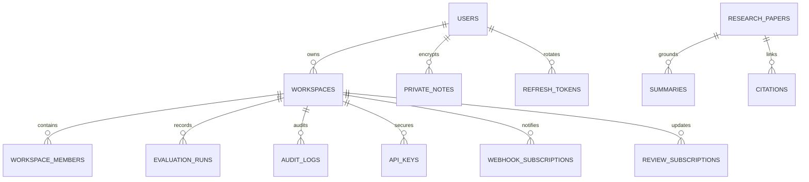
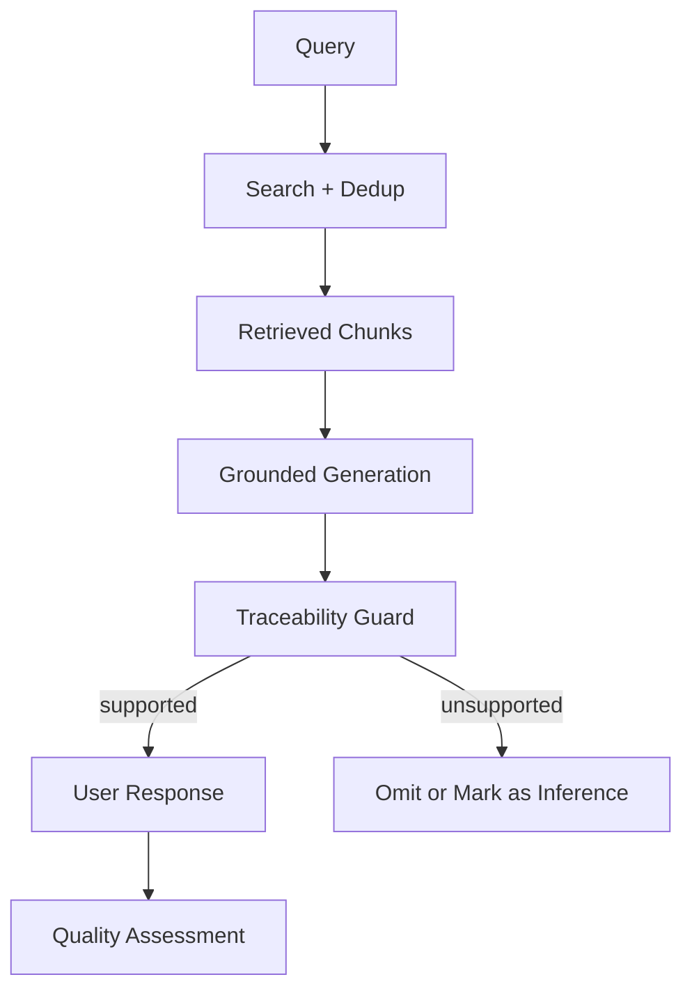

# Resora Non-Functional Requirements

## Quality Gates

- Every grounded answer must map each non-inference sentence to a retrieved chunk or source span.
- Any unsupported sentence should be omitted or explicitly marked as `AI inference, not from source`.
- Default runtime stack should stay free-tier friendly: Groq, FAISS-style local retrieval, Supabase free tier, and Redis-style cache abstraction.

## Target Thresholds

- First result latency target: `<= 1600ms`
- Full multi-source latency target: `<= 6000ms`
- RAG accuracy target: `>= 0.80`
- Dedup reduction target: `>= 0.42`
- Summary latency target on free-tier default path: `<= 15s`
- Multimodal incorrect-rate target for figure/table failure mode: `<= 0.05`
- Load-test target: `>= 50 concurrent users`

## Documentation

- OpenAPI docs remain available at `/docs`
- Versioned REST surface remains under `/api/v1`
- Architecture diagrams are extended rather than replaced

## Extended Diagrams

### System Flow

```mermaid
flowchart LR
    User --> UI[React PWA]
    UI --> API[FastAPI /api/v1]
    API --> Planner[Planner Agent]
    Planner --> Search[Search Agent]
    Planner --> Reading[Reading Agent]
    Planner --> Compare[Comparison Agent]
    Planner --> Critique[Critique Agent]
    Planner --> Gap[Gap Agent]
    Planner --> Writing[Writing Agent]
    Planner --> Citation[Citation Agent]
    Search --> Sources[OpenAlex / arXiv / CORE / PMC / S2 / Scholar / Crossref / Unpaywall]
    Reading --> Extract[PDF + OCR + Figure/Table/Equation Extraction]
    Search --> Retrieval[Hybrid Retrieval + Dedup + Vector Store]
    Citation --> Graph[Citation Graph Metrics]
    API --> Quality[Traceability + Quality Gates]
```

### ERD Extension

### Data Flow

## Accessibility Baseline

- WCAG 2.1 AA minimum
- Keyboard navigation
- Screen-reader-friendly labels
- High-contrast theme
- RTL Urdu support
- Mobile-first responsive layouts

